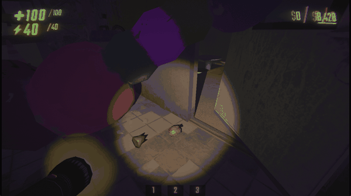

# Pockets

Keep valuables in your inventory slots and take them out again whenever you want. Small valuables by default, any size if you prefer.

> **Everyone in the lobby must install this mod.** Storing a valuable uses each player's own inventory keys and slot display, so friends without it would see an empty slot and could not use the pockets.

## Preview

<!-- Visual gameplay demo GIF (placed in assets/preview.gif) -->

## How to Use

1. **Store:** grab a small valuable and press the key of a free inventory slot (the same keys you use for your items). It disappears into your pocket.
2. **Take it out:** press the same slot key again. The valuable appears in front of you and ends up in your hands.
3. **Check it:** the slot shows a picture of the valuable and, if you like, its current value.

## Features

- **Pocket your loot:** carry valuables hands-free and keep them safe while you deal with monsters or move heavy things.
- **Same keys as your items:** no new controls; a pocketed valuable uses one of your inventory slots, so it competes with your tools and weapons.
- **A picture of each valuable:** every valuable has its own little image on the slot, plus its current value (you can turn the value off).
- **Fair to extraction:** a valuable in your pocket does not count toward the haul until you take it out and deliver it.
- **Nothing carries over:** valuables in your pockets are lost when the level ends.
- **If you die or leave:** your pocketed valuables drop where you fell or where you left. Switching the mod off drops them too, so nothing gets stuck.
- **Choose what fits:** by default only the smallest valuables fit; the host can allow bigger ones.

## Requirements
- [BepInEx Pack for R.E.P.O.](https://thunderstore.io/c/repo/p/BepInEx/BepInExPack/)

## Installation
1. Install the latest [BepInEx Pack](https://thunderstore.io/c/repo/p/BepInEx/BepInExPack/).
2. Install through r2modman / Thunderstore Mod Manager, or place `Pockets.dll` in your `BepInEx/plugins` folder. **All players need it.**
3. Launch the game once; the configuration file is created inside `BepInEx/config`.

## Configuration
All settings are in `com.osmar.Pockets.cfg` inside `BepInEx/config`.

- `Enabled` (default `true`): turn the mod on or off. Turning it off drops whatever is in your pockets.
- `MaxValuableSize` (default `Tiny`): the biggest valuable that fits in a pocket. Every smaller size fits too (Tiny, Small, Medium, Big, Wide, Tall, VeryTall). The host's choice applies to everyone.
- `DropOnDeath` (default `true`): drop your pocketed valuables where you die. The host's choice applies to everyone.
- `ShowSlotValue` (default `true`): show the stored valuable's value on its slot. Mods that depend on the value turn it on regardless.

## Issues & Bug Reports
The official way to report issues, suggest improvements, or submit feedback is by opening an issue on the official GitHub repository:
👉 [GitHub Issues](https://github.com/OsmarBriones/REPO-Pockets/issues)

## Credits
Developed by **Osmar Briones**
